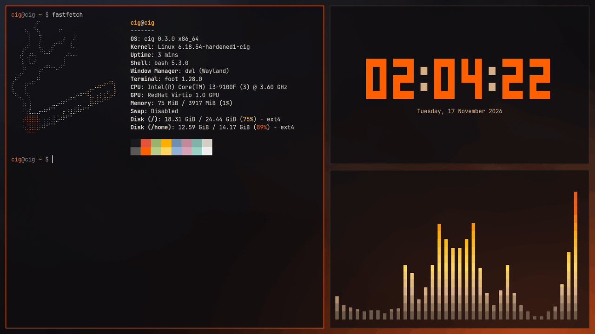
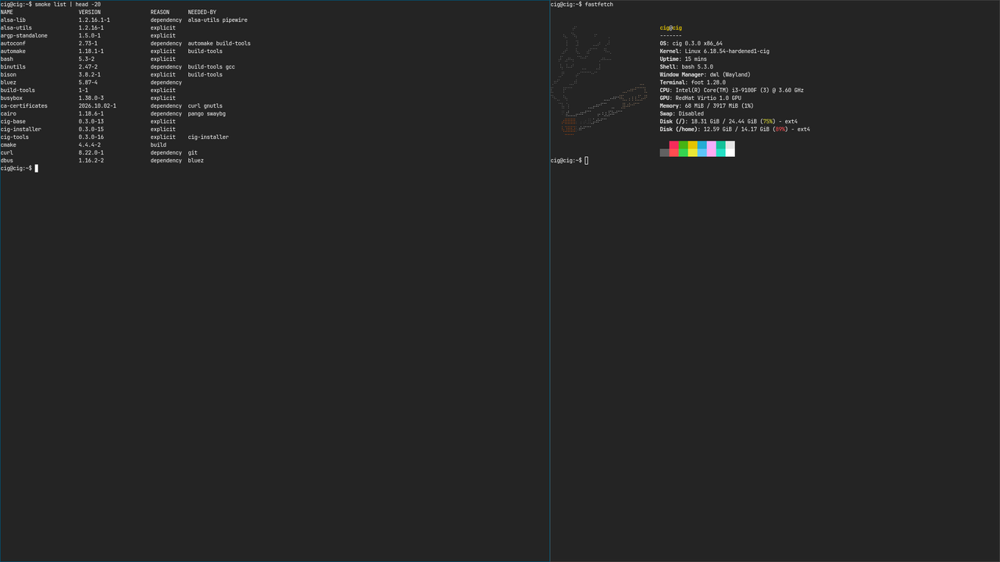
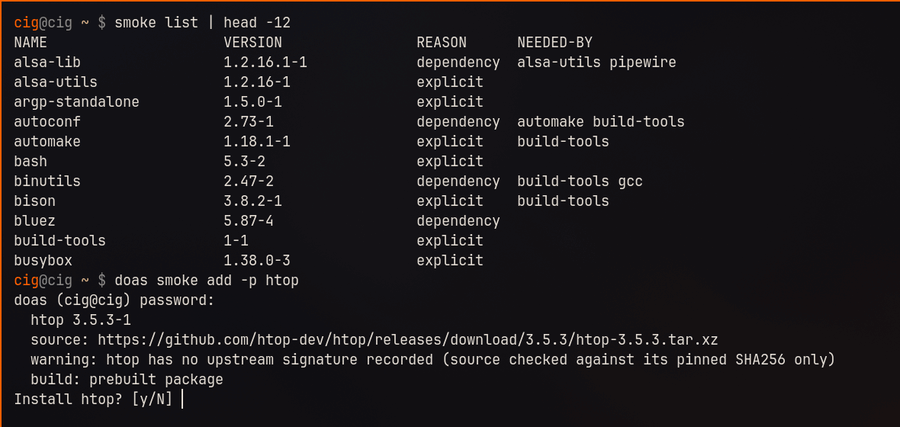
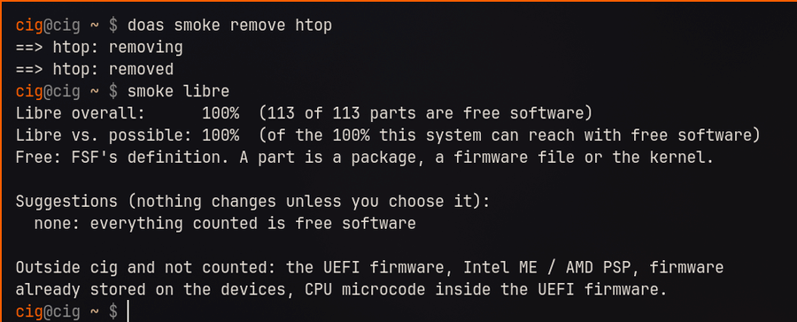

<h1 align="center">cig</h1>

<p align="center">
  <b>A minimal, hardened GNU/Linux distribution, built from source on the machine it runs on.</b><br>
  musl · BusyBox · sinit + runit · linux-hardened · EFISTUB · Wayland
</p>

<p align="center">
  <a href="https://github.com/moneroism/cig/releases"></a>
  <a href="LICENSE"></a>
  <a href="https://github.com/moneroism/cig/commits/main"></a>
  <a href="https://github.com/moneroism/cig/graphs/commit-activity"></a>
  <a href="https://github.com/moneroism/cig/issues"></a>
  <a href="docs/sources.md"></a>
</p>

<p align="center">
  
  <br><sub>A riced dwl session on cig 0.3.0: fastfetch, cava and peaclock in foot. The gaps, colours,
  wallpaper and the clock (peaclock, not a cig package) are user dotfiles; cig itself ships upstream
  defaults (see the stock look below).</sub>
</p>

In the spirit of GrapheneOS, but for the PC: as little code as possible, every source verified,
nothing running that isn't needed, and nothing hardcoded to one machine.

| | |
|---|---|
| **Base** | musl, BusyBox, sinit (PID 1, ~100 lines) + BusyBox runit, mdev, no systemd / udev / logind / X11 |
| **Kernel** | linux-hardened 6.18 LTS, configured for the machine it runs on, signed modules, lockdown, booted by EFISTUB |
| **Desktop** | Wayland: dwl + foot by default; sway, labwc, Chromium, PipeWire, Bluetooth and more as optional components |
| **Packages** | `cigbuild` builds from recipes, `smoke` installs, audits and updates; every source pinned and, where upstream signs, GPG-checked |
| **Footprint** | about 100 MB of RAM after boot with dwl |

> **Status:** 0.3.0 (beta), 0.4.0 in preparation. A bootable install medium (hybrid ISO: CD/DVD or
> USB stick) runs a live system, and its installer installs a system that boots on its own with its
> own linux-hardened kernel, signed modules and lockdown, and a Wayland desktop: tested in QEMU (UEFI)
> and installed on a laptop (ASUS E210MA, eMMC). Phase 4 (optional components, the browser, the
> libre-meter, `smoke update` from signed releases) is done in QEMU; its laptop test makes 0.4.0.
> Not for daily use yet. See [`ROADMAP.md`](ROADMAP.md).

## Screenshots

<table>
  <tr>
    <td width="50%"></td>
    <td width="50%"></td>
  </tr>
  <tr>
    <td><sub>The stock look: dwl and foot with their upstream defaults (smoke list, fastfetch).</sub></td>
    <td><sub><code>smoke add</code> shows the source, its signature status and how it will be built, then asks.</sub></td>
  </tr>
  <tr>
    <td></td>
    <td valign="top"><sub><code>smoke libre</code>, the libre-meter: how much of the installed system is free software, and
    what could change that. Short videos of the same session are attached to the releases.</sub></td>
  </tr>
</table>

## Principles

- **Minimal attack surface.** Small implementations are preferred (musl,
  BusyBox, sinit, samurai); features nobody uses are compiled out.
- **Every source verified.** Recipes pin a SHA256; `cigbuild pin` checks the
  upstream GPG signature before a checksum is pinned, and only from the keys the
  recipe names (`keys=`, recorded on first use): a signature by any other key stops
  the pin. Sources without an upstream signature are marked as trust-on-first-use, openly.
- **Compiled on the machine.** The kernel is configured for the hardware it
  runs on, with a module signing key that is generated during the build and
  deleted afterwards, so every installation has its own key.
- **Nothing hardcoded.** Hardware-dependent choices (GPU drivers, kernel
  drivers, firmware) are detected or chosen, never fixed to one machine.
  Every optional component can be deselected.
- **Upstream defaults.** No theming; users configure their own system.
- **Auditable.** One readable inventory says what is installed and why;
  `smoke audit` checks the whole system against it.

## Versions

A version is `X.Y.Z`:

| Part | Meaning | Example |
|---|---|---|
| **X**.y.z | a **stable** release, ready for daily use on real hardware; 1.0.0 is the first | 1.0.0, 2.0.0 |
| x.**Y**.z | a **beta** release: one more phase of the [roadmap](ROADMAP.md) reached; runs on hardware but is not stable yet | 0.3.0, 0.4.0 |
| x.y.**Z** | a **patch** to that stable or beta release: fixes and small additions that don't work towards the next version (like a hotfix) | 0.3.1, 1.0.1 |

The current version is in [`VERSION`](VERSION); every installed system has it in
`/usr/lib/os-release`, and the install medium is `cig-<version>.iso`. Which phase each
version reached is listed in [`ROADMAP.md`](ROADMAP.md#versions).

## Design

| Area | Choice |
|---|---|
| Kernel | [linux-hardened](https://github.com/anthraxx/linux-hardened) 6.18 LTS, configured per machine |
| C library | musl |
| Userland | BusyBox (trimmed: no network daemons, no `su`, no setuid, no BusyBox TLS) |
| Init | sinit (PID 1, ~100 lines) + BusyBox runit applets for supervision. At boot `rc.init` checks the root filesystem while it is read-only (`fsck.<type> -p`; fstab's pass column, 0 = never), then mounts it read-write with its options from `/etc/fstab`. Errors the check cannot repair stop the boot with a message: root's password gives a shell there; with root locked (the default) Enter boots on, and the repair is done from the install medium |
| Devices | devtmpfs + BusyBox mdev, libudev-zero, seatd (no udev, no logind) |
| Boot | EFISTUB, no bootloader; the command line is compiled in |
| Admin | doas, for members of `wheel` (the only setuid program). `/etc/doas.conf` says `persist`: after a password the same terminal is not asked again for five minutes – a choice for usability; remove the word to be asked every time |
| Packages | `cigbuild` builds, `smoke` installs: every package in its own folder under `/usr/pkg` |
| TLS | OpenSSL 3.5 LTS |
| Desktop | Wayland: dwl, foot (sway, labwc optional); CPU rendering (pixman) for now. No X11. |
| D-Bus | only with optional components that cannot work without it, all off by default: Bluetooth (BlueZ), the iwd WiFi daemon and the mako notification daemon (a session bus that startdwl starts only with mako); the system bus service runs only with BlueZ or iwd. Without BlueZ the Bluetooth drivers stay unloaded too (`cig-modload`; BlueZ installed later loads them when its service starts). PipeWire's Bluetooth audio is its own optional component (`pipewire-bluetooth`) for the same reason |
| Sound | ALSA; PipeWire optional (off by default): WirePlumber, PulseAudio and ALSA compatibility, started per desktop session by `pipewire-launcher` (no systemd user units, no D-Bus); with it installed, ALSA programs play through PipeWire, so they need a running session |
| Time | chrony with NTS (authenticated) to Netnod and PTB; Cloudflare only if neither answers within 60 s. Optional: off, no time server sees the machine |

### Hardening

- Module signing enforced; the private key is deleted after the build.
- Kernel lockdown (integrity); optional runtime lock of module loading
  (`/etc/lock-modules`).
- GCC hardening plugins of linux-hardened (latent_entropy, stackleak, randstruct;
  the last two since linux rel 3: kernels built before have only latent_entropy).
- Protocol families nothing on cig uses are not built (RDS, TIPC, ATM, X.25, Phonet,
  RxRPC, IEEE 802.15.4, CAN, vsock, SCTP, AppleTalk, NFC, L2TP, PPPoE, mISDN): as modules,
  any user's `socket()` call would load them.
- Built-in command line: `slab_nomerge`, `init_on_alloc`, `init_on_free`,
  `page_alloc.shuffle`, `randomize_kstack_offset`, `vsyscall=none`, `debugfs=off`.
- sysctl: restricted kernel pointers and dmesg, ptrace scope 2, no unprivileged
  BPF or user namespaces, no kexec, no SysRq, IPv6 privacy addresses
  (`/etc/sysctl.conf`, additions in `/etc/sysctl.d/`).
- Everything compiled with PIE and stack protector by default; full RELRO.
- `/tmp` in RAM with `noexec`; `/home` with `nosuid,nodev`; the EFI partition
  is not mounted during normal use.
- No CPU microcode is ever shipped. Firmware: only the files the machine's
  drivers load (installer), and never a non-free file that has a free replacement.
- curl: HTTP(S) and FILE only. wpa_supplicant: WPA2/WPA3-Personal only (no WPS,
  EAP or D-Bus), MAC randomization.

## Repository

```
cigbuild            build tool: recipe -> verified source -> package (shell, as recipes are)
lib/                cigbuild's shared code (recipes, build styles, hardware detection)
src/smoke/          smoke, the package manager (C; package cig-tools)
src/installer/      cig-install, the installer (C, ncurses; package cig-installer, media only);
                    test/run.sh checks the partition logic against reference results
src/pixel/          pixel, terminal animations (C; package pixel)
src/clock/          clock, the time in large digits for the terminal (C; package clock)
packages/<name>/    one recipe per package (+ files/ for extra files)
assets/             logos and banners (ASCII and braille), with their size and colour rules
scripts/            bootstrap, the install media (build-media.sh), release signing and VM helpers
VERSION             the cig release (see "Versions")
docs/               design documents: smoke, sources (how every source is authenticated)
kernel/             earlier kernel configs (reference)
ROADMAP.md          goals and phases
```

## cigbuild

Builds packages. Runs inside cig itself (chroot, installer, installed
system); needs only bash, curl and BusyBox. Pinning with signature checks
needs gpg, so it is done on the host.

```
cigbuild build   <pkg>...   fetch + verify + build a package (dependencies via smoke)
cigbuild install <pkg>...   same as: smoke add -c -y
cigbuild rebuild <pkg>...   build again from source; smoke switches to the new build
cigbuild pin     <pkg>...   verify upstream signature, pin the SHA256
cigbuild sig     <pkg> <url|->...  check pinned sources against upstream signatures, record the URLs
cigbuild keys    <pkg>...   check pinned sources again, record their signing keys (keys=)
cigbuild trust   <pkg> <fpr>  accept one more signing key (only after checking it independently)
cigbuild info    <pkg>      show a recipe
cigbuild pkgfile <pkg>      path of the package file for the current recipe
```

Packages are tarballs with a file list and checksum in `/var/cig/pkgs/`.
All package contents are owned by root. After `/bin`, `/sbin` and `/lib` are
merged into `/usr`, relative links that would point outside the package are
rewritten automatically.

### Recipe format

```sh
name=dwl
version=0.8
license="GPL-3.0-or-later AND MIT AND CC0-1.0"   # SPDX expression (the libre-meter reads it)
source="https://codeberg.org/dwl/dwl/releases/download/v$version/dwl-v$version.tar.gz"
signature=""                 # signature URL per source, or "-"
keys=""                      # fingerprints allowed to sign (filled in by pin/sig/keys; new ones: cigbuild trust)
sha256=""                    # filled in by: cigbuild pin dwl (a signed source is checked against
                             # both on every device: the signature with gpgv, then this hash)
depends="wlroots libinput libxkbcommon wayland"
makedepends="wayland-protocols pkgconf"
style=make                   # gnu | meson | make | custom
```

Optional: `rel`, `configure_args`, `meson_args`, `make_args`, `wrksrc`,
`keep_static` (keep `*.a`, e.g. gcc's libgcc.a, musl's stubs), `nostrip`,
`noextract` (the recipe unpacks its sources itself, e.g. linux-firmware),
`config_files`, `link_dirs` (link a whole directory, e.g. kernel modules),
`copy_files` (install as a real copy, e.g. python), and the functions
`pre_build`, `do_build`, `do_install`, `post_install`. Sources may be written as
`filename::url`. Meson options that a package version doesn't define are
dropped and reported in the build log.

### Hardware-dependent builds

| Variable | Effect |
|---|---|
| `CIG_GPUS="amd intel"` | GPU vendors to build for (default: detected from `/sys`) |
| `CIG_PROFILE=generic` | build for all common hardware (prebuilt packages, install media) |
| `CIG_KERNEL_PROFILE=local\|generic` | kernel drivers: this machine (`lsmod`) or everything |
| `CIG_KERNEL_EXTRA_MODULES` | always include these kernel modules |
| `CIG_KERNEL_CMDLINE_EXTRA` | appended to the built-in command line |
| `CIG_ROOT` | root device (default `PARTLABEL=cig-root`) |
| `CIG_FIRMWARE=all` | install all firmware instead of the detected set |
| `/etc/cig/firmware.list` | explicit firmware list (the installer writes this) |
| `/etc/cig/efi-fallback` | only for kernels built before 2026-10-07: also install as `EFI/BOOT/BOOTX64.EFI` (newer kernels always go there) |

The kernel base config is Alpine's `linux-lts` (pinned commit) with cig's
settings from `packages/linux/files/cig.config` on top; a reviewed cig base
config is planned.

## smoke

Installs, removes and audits packages.

```
/usr/pkg/<name>/<version>-<rel>-<id>/     the package's files
/usr/pkg/<name>/<...>/.meta/              file list, checksums, install hook, pristine /etc files
/usr/bin, /usr/lib, ...                   links into /usr/pkg
/etc                                      real files (editable)
/usr/pkg/INVENTORY                        what is installed and why (sealed with a checksum)
```

```
smoke add [-c|-p] [-y] <pkg>.. add and install: asks "compile on this device?" (-c yes, also
                               every missing dependency; -p use prebuilt packages) and
                               "install?" (-y no questions)
smoke remove  <pkg>...         remove, then its own dependencies nothing needs any more
smoke autoremove               remove every orphaned dependency
smoke update [-c|-p] [-y] [<pkg>...]
                               rebuild packages whose recipe changed (dependencies first),
                               report newer upstream releases, then check that every
                               program still finds its libraries; --check only reports
smoke list [-a [<word>]]       packages, reason, who needs them (-a: every available recipe
                               by category; a word searches name, description and category)
smoke why     <pkg>            why a package is installed
smoke files   <pkg>            files of a package
smoke mark    <reason> <pkg>   explicit | dependency | build
smoke audit [--quick]          check the system against the inventory
smoke seal                     accept an inventory changed outside smoke (shows the change, asks)
smoke hooks   <pkg>... | --all run a package's setup again
smoke libre                    how much of this system is free software (libre-meter)
```

Install reasons: **explicit** (asked for), **dependency** (needed by another
package; removed automatically when nothing needs it), **build** (build tools;
never removed automatically).

Every build gets its own folder, so links switch atomically: even the running C
library or shell is replaced safely, and the old build is removed afterwards.
Config files changed by the user are kept; the new version is saved as `*.new`.

`smoke audit` reports: package folders not in the inventory, modified package
files, files in `/usr` that are not links into `/usr/pkg`, broken links, links
replaced by real files, libraries a program cannot find or takes from a package
its own does not depend on (it would break with another selection), changed
configuration, orphaned dependencies, and a hand-edited inventory. smoke then refuses to install or remove anything
until `smoke seal` accepted it: it prints the lines that changed since smoke last
wrote the file (it keeps a copy, `INVENTORY.sealed`), asks, and seals the file as it is.
`--quick` skips the package checksums. Paths in `/etc/smoke/audit.ignore` are
skipped.

Upstream releases: `cigbuild latest <pkg>...` finds each recipe's newest stable release
(git tags, download pages, PyPI); `scripts/check-updates.sh` prints the table for all
recipes. A recipe may limit it with `track=` (a version series, e.g. the kernel's LTS),
`stable=` (a pattern) or point it elsewhere with `upstream=` / `upstream_version()`.

## Installing

`cig-install` (run as root on the install medium's live system) shows one main menu
with every section and its current value, like archinstall: arrow keys move, Enter
edits a section, Esc goes back, Install is at the bottom.

| Section | |
|---|---|
| Disk | target disk (the running system's disk is not offered); **auto** (erase, default layout: ESP 512M, system, optional swap and `/home`) or **custom** (partition editor: keep, delete, add, format, mount points) |
| Identity | hostname, user (in `wheel`, `audio`, `video`, `users`; not in `input`, whose members can read every key typed on the machine: the compositors get their input through seatd. A program that opens `/dev/input` itself needs `addgroup <user> input`), root locked or with password |
| Components | from the recipes' `group=` / `default=`, under category headings, `/` searches; each with its installed size (itself and the dependencies the base does not have; `size=` in each package's `.PKGINFO`, collected by build-media into `/var/cig/pkgs/sizes`) and whether its upstream signs releases; the selection's total in the main menu; base packages always |
| Hardware, network | detected GPU and network, firmware per driver (toggle; only the files each driver loaded on the medium, not its whole `firmware=` list: amdgpu names every GPU generation's; a driver that loaded none is unchecked, and checking it installs its whole list), optional WiFi network (picked from a scan, or typed for a hidden one; WPA2/WPA3-Personal, the password typed once); DNS: **encrypted** (DNS over TLS to Quad9 and Cloudflare through unbound, default), unbound as its **own resolver** (no third party), or the **network's** DHCP DNS |
| Security | optional layers (placeholders for now) |
| Build | packages compiled here or prebuilt; kernel compiled for this machine (default) or the medium's generic kernel (with a warning) |

Nothing is written before the summary and typing the disk name; the summary
lists every partition that is deleted or formatted. The installer writes the
partition table in one step (GPT: ESP, `cig-root`, optional `cig-swap` and
`cig-home`; kept partitions keep their place and IDs, so an existing `/home` or
another system's ESP can stay), formats, writes fstab by UUID,
installs the packages with smoke, compiles the kernel for the detected hardware
(root found by PARTUUID, its own module signing key), runs the package setup,
creates the users, and enables networking. An optional component that fails to build is
skipped and listed at the end (a base package stops the install). The medium is a
**netinstall** medium (since 0.4.1): before it changes the disk, the installer connects (a
network cable, or the WiFi network chosen at the start) and, for prebuilt packages,
checks cig's package pool (its index must carry a valid signature by a cig release key; see
docs/smoke.md). Prebuilt packages come from the pool, sources from their upstreams, and the
machine's firmware files from the live system's firmware (no download). Later, `smoke add -p`
fetches a package from the pool when it is added. It ends with `smoke audit` against the new
system: it must contain exactly what was chosen. Log: `/var/log/cig-install.log`.

The kernel is installed as `EFI/BOOT/BOOTX64.EFI`, the path every UEFI firmware finds
(some find no other), and the installer also adds a firmware boot entry "cig" for that
file. The previous kernel stays as `EFI/cig/vmlinuz-old.efi` (choose it in the firmware's
boot menu).

### Libre-meter

Before installing (main menu, "Libre-meter") and on an installed system (`smoke libre`),
cig reports how much of the system is free software by the FSF's definition. Every
package, every firmware file and the kernel count as one part each:

- **Libre overall**: the share of free parts.
- **Libre vs. possible**: that share compared with the best one this hardware can reach
  with free software, so a machine that needs a blob is not judged against an ideal it
  cannot meet.

A package is free when its `license=` (SPDX) is on the FSF's list: the licenses the SPDX
license list marks `isFsfLibre` (`libre/licenses-fsf`, written by
`scripts/update-libre-licenses.sh <version>`), plus `libre/licenses-cig`, reviewed matches of
entries on gnu.org's list that SPDX does not flag. A license on neither list is shown as
"not reviewed". A firmware file is free when linux-firmware's WHENCE gives it a free
licence and includes its source, or when `libre/firmware` names where its source is
kept. Anything else is non-free, including firmware with a free licence but no source. The
kernel counts as not free while it loads non-free firmware. Suggestions come first as
software changes. A non-free file with a free replacement that loses no function
(`libre/alternatives`, e.g. ath9k_htc's open 1.4.0 firmware, which the driver tries first)
is never installed: linux-firmware installs the free one instead. Leaving out a driver's firmware is possible on
the firmware screen, at the cost of that device. What lies outside cig is named but not
counted: the UEFI firmware, Intel ME / AMD PSP, firmware stored on the devices, and CPU
microcode inside the UEFI firmware. `make -C src/libre test` checks the license logic.

### The install medium

`scripts/build-media.sh` (in the dev chroot, as root) builds `cig-<version>.iso`, a hybrid
ISO that boots through UEFI from CD/DVD and from a USB stick it was written to: the live
system as ISO 9660 with Rock Ridge, and an EFI system partition (the medium's kernel as
`EFI/BOOT/BOOTX64.EFI`) used for El Torito and appended as a GPT partition. Only the
medium's kernel has an initramfs (`scripts/initramfs/init`, built into it): it finds the
ISO by its volume label `CIG_<version>`, mounts it and starts the live system. It boots as a live system: the medium stays read-only, `/etc`, `/var`, `/home`, `/root`
and `/mnt` live in RAM; the medium carries the live system (all of linux-firmware,
zstd-compressed), the installer and the generic install kernel, no packages or sources. Logins: `root` and `cig`, password `ciglinux` (nothing on the
live system listens on the network; it starts only the logins and seatd). If more than one
device carries the label, it stops and names them: a disk with a copy of the ISO is not
started by mistake. Write it to a USB stick with
`xzcat cig-<version>.iso.xz | dd of=/dev/<the stick> bs=4M conv=fsync` (or Etcher / Rufus).

On a USB stick the image also has a small writable FAT partition, `CIG-DATA`. `cig-check`
(log in as root on the live system) checks the machine's hardware and stress-tests it:
devices and drivers, kernel errors, firmware, graphics, storage (read only), WiFi, Bluetooth,
sound, touchpad, backlight, battery, a 60 s CPU load, a memory pattern test and suspend. It
asks a few yes/no questions at the keyboard (`--no-ask` skips them, `--quick` skips the stress
and suspend tests) and saves its report to `CIG-DATA`, without MAC addresses, network names or
serial numbers. It never writes to the machine's disks. The installer runs it once before
partitioning (`--quick --no-ask`) and keeps the report in its log. cig-check is temporary, its
own package (`packages/cig-check`). It is also a component (Tools, off by default), so an
installed system can check itself (`doas cig-check`: RAM with a breakdown, the WiFi connection,
sound, suspend); the report goes to `CIG-DATA` when the stick is plugged in, else to /root.

### Verifying a release

From the release after 0.3.0 on, every release has a signed git tag `v<version>` and, next
to the ISO, `SHA256SUMS` with its detached signature `SHA256SUMS.asc` (both by the release
key, `CD38EABE19D767349A620576BFD64F1940F00EA2`, in `release-key` and `keys/`). The ISO is
published compressed, `cig-<version>.iso.xz` (Etcher and Rufus write it directly). With the
release key imported:

```
gpg --verify SHA256SUMS.asc SHA256SUMS && sha256sum -c --ignore-missing SHA256SUMS
xz -d cig-<version>.iso.xz                                          # the ISO (also listed)
git verify-tag v<version>                                           # the source
```

Each release also carries `cig-release.tar.gz` (the tag's tree) and its signature
`cig-release.tar.gz.sig`: installed systems update themselves from it (`smoke update`, see
docs/smoke.md), accepting it only with a valid signature by a key listed in `release-key`
and never older than what is installed.

The developer signs with `CIG_SIGNING_KEY=<fingerprint> scripts/sign-release.sh
cig-<version>.iso` (the key must be listed in `release-key` with its public half in
`keys/<fingerprint>.gpg`, both committed; makes or checks the tag on the current commit,
writes `cig-<version>.iso.xz`, writes and signs `cig-release.tar.gz` and `SHA256SUMS`,
verifies them, pushes and uploads nothing). The release must be GitHub's "latest" release: `smoke update` fetches
`releases/latest/download/`. `v0.2.0` and `v0.3.0` are unsigned.

### Testing in QEMU

```
qemu-img create -f raw ~/cig-target.img 40G
CIG_CDROM=~/cig/cig-0.3.0.iso CIG_TARGET=~/cig-target.img scripts/run-vm.sh   # the ISO as a CD
CIG_IMG=~/cig/cig-0.3.0.iso CIG_TARGET=~/cig-target.img scripts/run-vm.sh     # as a disk (like a USB stick)
# in the VM, as root:  cig-install
CIG_IMG=~/cig-target.img scripts/run-vm.sh      # boot the installed disk alone
```

`CIG_VM_MONITOR=<socket>` adds a QEMU monitor on a unix socket: `screendump <file> -f png`
and `sendkey` let a test run without a person at the VM window.

Boot an installed target disk alone, never together with the dev image: both
contain a partition named `cig-root`. Recreate the target image for each test.

## Building

Host: Void Linux (x86_64). The bootstrap creates a disk image with a musl
toolchain and a minimal system; from there `cigbuild` builds everything.

| # | Step | Where |
|---|---|---|
| 1 | `scripts/build-toolchain.sh`, `scripts/build-temp.sh` | host: versions and signing keys from the recipes (`keys/`), sources checked with gpgv |
| 2 | `scripts/enter-chroot.sh [-c "<command>"]` | host (sudo), mounts the repo at `/cig`; `cigbuild` from the repo, the installed C `smoke` with the repo's recipes |
| 3 | `scripts/prepare-base.sh` → `build-base.sh` | host → chroot |
| 4 | `cigbuild pin ...` | host (gpg) |
| 5 | `smoke add -c <packages>` | chroot |
| 6 | `scripts/build-media.sh` | chroot: the install medium (after the media kernel and firmware, see the script) |
| 7 | `scripts/run-vm.sh` | host: boot an image in QEMU (UEFI) |

The bootstrap scripts will be replaced by building from the install medium.

cig is an independent distribution built from scratch. The bootstrap method
(cross toolchain → temporary tools → chroot → final system) was inspired by
Linux From Scratch and Musl-LFS; cig does not follow either book.

## Pinned versions and why

| Package | Pin | Reason |
|---|---|---|
| gawk | 5.3.x | gawk 5.4 makes GCC 16's option generator produce broken output |
| git | 2.x, `NO_RUST=1` | git 2.54+ builds Rust by default; git 3.0 makes Rust mandatory |
| Python | 3.13.x | last series with GPG-signed releases; build tool only |
| make, flex, gmp, mpfr, mpc | built as C17 | pre-C23 code; GCC 15+ defaults to C23 |
| ninja | samurai | same job in C, ~4k lines |
| musl | provides `ldd` | autoconf's `config.guess` detects musl via `ldd --version` |
| gcc, binutils | explicit `x86_64-pc-linux-musl` | never let the build guess the system type |

## Roadmap

See [`ROADMAP.md`](ROADMAP.md). In short:

- [x] Phase 0 – Foundation: toolchain, userland, init, desktop, cigbuild, kernel, firmware
- [x] Phase 1 – smoke: symlink farm, inventory with install reasons, autoremove, audit
- [x] Phase 2 – Installer (TUI), tested in QEMU (0.2.0)
- [x] Phase 3 – Install media (ISO), first bare-metal install, basic usability (ALSA, clipboard, screenshots, DNS) (0.3.0)
- [ ] 0.3.x – GPU acceleration: Mesa without LLVM (RADV + Zink); built, not yet tested on an AMD GPU
- [ ] Phase 4 – Optional components (PipeWire, Bluetooth, sway, labwc, Chromium, ...), libre-meter, `smoke update` from signed releases: done in QEMU, laptop test pending (0.4.0)
- [ ] Phase 5 – Security layers (allowlisting), read-only root, own kernel base config
- [ ] Phase 6 – cig as a daily system, hardened_malloc, sandboxing
- [ ] Phase 7 – Code quality: sanitizers, strict flags, fuzzing

## License

```
cig - a minimal, hardened GNU/Linux distribution.
Copyright (C) 2026 moneroism

This program is free software: you can redistribute it and/or modify
it under the terms of the GNU General Public License as published by
the Free Software Foundation, either version 3 of the License, or
(at your option) any later version.

This program is distributed in the hope that it will be useful,
but WITHOUT ANY WARRANTY; without even the implied warranty of
MERCHANTABILITY or FITNESS FOR A PARTICULAR PURPOSE.  See the
GNU General Public License for more details.

You should have received a copy of the GNU General Public License
along with this program.  If not, see https://www.gnu.org/licenses/.
```

The full license text is in [`LICENSE`](LICENSE).
